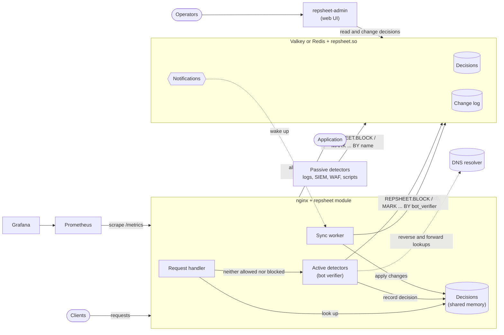

# Repsheet

Repsheet enforces reputation decisions at the edge. An actor (an IP
address, a network, a session, an API key) is **blocked**, **allowed**, or
**marked**, and nginx acts on that decision on every request, in memory,
without a network round trip.

Decisions come from **detectors** and from people:

* **Active detectors** run inside nginx, in real time. The first is the
  [bot verifier](docs/configuration.md#bot-verifier), which catches clients
  pretending to be search engine crawlers.
* **Passive detectors** run out of band, on logs or other signals, and write
  decisions into Valkey. Anything that can send a Redis command can be one:
  your SIEM, a WAF, a script, a log pipeline.
* **People**, through the [admin UI](docs/admin.md) or `valkey-cli`.



* **block**: nginx rejects the request (403 by default).
* **allow**: the actor is trusted, which overrides any block or mark.
* **mark**: the request goes through, and `$repsheet_status`,
  `$repsheet_reason` and `$repsheet_actor` let you pass the signal to the
  application, log it, or feed it into `limit_req`.

## How it works

| Directory | What it is |
|-----------|------------|
| `redis/`  | A module for Valkey (≥ 7.2) and Redis (≥ 7.2). It is the source of truth: it validates and canonicalizes actors, stores decisions with optional TTLs, and keeps an ordered change log. |
| `nginx/`  | An nginx module. It holds a full copy of the decisions in shared memory, evaluates every request against it, and runs the active detectors. |
| `admin/`  | `repsheet-admin`, a web UI for viewing and managing decisions (Rust). |
| `detectors/` | How detectors work; the passive detector contract. |
| `bench/`  | `repsheet-bench`, which measures Repsheet's per-request overhead (Rust). |
| `common/` | Actor parsing and canonicalization shared by the modules and the admin UI. |

nginx never queries Valkey while handling a request. One worker keeps the
shared memory copy in sync: it loads a snapshot in pages, then follows the
change log, woken by a notification as soon as a decision changes. If Valkey
is slow or unreachable, requests are served from the last known decisions
while the worker reconnects. Decisions survive `nginx -s reload`.

## Quick start (Docker)

```sh
make docker-up                                  # or: docker compose -f examples/docker-compose.yml up --build -d
curl -i localhost:8080/                         # 200

# Find the address nginx sees for you (the Docker gateway), then block it.
docker compose -f examples/docker-compose.yml logs nginx | tail -1
docker compose -f examples/docker-compose.yml exec valkey \
    valkey-cli REPSHEET.BLOCK 172.16.0.0/12 REASON demo
curl -i localhost:8080/                         # 403
curl -s localhost:8080/metrics
```

The admin UI is on http://localhost:8090. Grafana on http://localhost:3000
shows the Repsheet dashboard (decisions, requests by decision, sync health,
zone usage, and the bot verifier's claims, answer sources and lookup
latency), fed by Prometheus on http://localhost:9090 scraping `/metrics`
every 5 seconds. `make docker-logs` follows the logs and `make docker-down`
stops everything.

The Prometheus scrape config and the dashboard are in `examples/monitoring/`
(`grafana/dashboards/repsheet.json` can be imported into any Grafana with a
Prometheus data source).

`examples/` also shows how to pass marks to an upstream and how to rate limit
marked actors.

## Documentation

* [Managing decisions](docs/decisions.md): actors, commands, how decisions
  apply, and the data layout in Valkey.
* [Configuration](docs/configuration.md): nginx directives, variables,
  metrics, and the bot verifier.
* [Admin UI](docs/admin.md): running `repsheet-admin` and putting it behind
  an authenticating proxy.
* [Detectors](detectors/README.md): active and passive detectors, and the
  contract for writing one.
* [Performance](docs/performance.md): what Repsheet costs per request, and
  how to measure it.

## Building

Requirements: a C compiler, make, hiredis ≥ 1.0 (for nginx), and nginx
sources. The admin UI needs a Rust toolchain (1.88 or later). The tests need
[uv](https://docs.astral.sh/uv/).

```sh
make bootstrap   # fetch + build pinned hiredis, Valkey and nginx into .deps/
make             # build redis/repsheet.so, nginx with the module, and repsheet-admin
make test        # pytest suite against real Valkey, nginx and the admin UI
make sanitize    # the same suite with ASan/UBSan on the module, Valkey and nginx
make bench       # performance benchmarks (see docs/performance.md)

make run-valkey  # Valkey with the module on 127.0.0.1:6379 (VALKEY_PORT=...)
make run-admin   # the admin UI on 127.0.0.1:8090 (REDIS=..., ADMIN_ARGS=...)
make docker-up   # Valkey + nginx + admin UI in Docker; docker-logs, docker-down
```

The nginx module builds statically (`--add-module=/path/to/repsheet/nginx`)
or as a dynamic module (`--add-dynamic-module=...`, then `load_module`). To
build against a packaged nginx, configure the same nginx version with
`--with-compat` and run `make modules`. The `Dockerfile` does exactly this.

`script/bootstrap` takes `NGINX_VERSION`, `VALKEY_VERSION`,
`HIREDIS_VERSION`, `DYNAMIC=1` and `SANITIZE=1`. To test against Redis
instead of Valkey, set `REPSHEET_SERVER=/path/to/redis-server`.

CI covers Valkey 9.1 and Redis 8.10, nginx 1.30 (stable) and 1.31
(mainline), static and dynamic builds, a sanitizer run, and the admin UI
(rustfmt, clippy, unit and integration tests).

## Releasing

Set the new version in `redis/src/repsheet.c` (`REPSHEET_VERSION`),
`admin/Cargo.toml` and `bench/Cargo.toml` (then `cargo update -w` in each),
commit, and push a tag:

```sh
git tag -a v6.1.0 -m "Repsheet 6.1.0"
git push origin v6.1.0
```

The release workflow checks that the tag matches the code
(`script/check-version`), runs the full CI suite, and publishes a GitHub
Release with notes generated from the changes since the previous release.
A tag with a suffix (`v6.1.0-rc.1`) becomes a pre-release.

## License

Apache 2.0. `redis/include/redismodule.h` is from Redis 7.2.4 (BSD 3-Clause).
