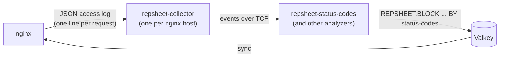

# Passive detectors

A passive detector is any program that reads signals outside the request
path (access logs, application events, threat intelligence, a SIEM) and
turns them into Repsheet decisions. It needs nothing from nginx: it talks to
the same Valkey/Redis (with the Repsheet module loaded) that nginx syncs
from.

## The contract

**Write decisions with the Repsheet commands.**

```
REPSHEET.BLOCK <actor> REASON <why> TTL <seconds> BY <detector>
REPSHEET.MARK  <actor> REASON <why> TTL <seconds> BY <detector>
```

* **Actor.** An address or network (`203.0.113.9`, `198.51.100.0/24`,
  `2001:db8::/48`) or `<type>:<value>` for anything nginx can see through
  `repsheet_actor` (`session:…`, `api_key:…`). The module canonicalizes it.
* **Always set a TTL.** Detectors are wrong sometimes; decisions should age
  out unless the detector keeps seeing the behavior and writes again.
* **`BY` is the detector's name** (`log-404-scanner`, `credential-stuffing`).
  It is stored with the decision and in the change log, and the admin UI
  shows it. Keep it short and stable.
* **`REASON` says what was seen**, briefly, for whoever reviews it later:
  `"312 404s in 60s"`, not `"bad"`.
* **Prefer `MARK` when unsure.** A mark lets the request through and tells
  nginx and the application (`$repsheet_status`, `$repsheet_reason`); pair it
  with `limit_req` to slow an actor down instead of shutting it out.
* **Do not write `ALLOW`** unless the detector is the source of truth for
  trusted actors. An allow overrides every block, including other
  detectors'.
* **Writing again is fine.** A new decision replaces the previous one for
  that actor and restarts its TTL. To lift one early, `REPSHEET.CLEAR <actor>
  BY <detector>`.
* **Write to the primary.** nginx may sync from replicas; replicas refuse
  writes.

**Reading.** `REPSHEET.CHECK <actor>` shows what nginx would do for an
actor, including network matches. `{repsheet}:changes` is a stream of every
change (with `by` and `at`) if a detector needs to react to others' decisions
or avoid repeating them.

## Getting traffic from nginx



nginx writes a second access log with one JSON object per request. A
**collector** next to each nginx follows that file and forwards every
request, as an event, to one or more **analyzers**. Analyzers decide and
write to Valkey; every nginx then enforces the decision through its normal
sync. Nothing here is on the request path: if the collector or an analyzer
is down, nginx serves requests exactly as before.

### nginx

```nginx
# http {}: print this with `repsheet-collector --print-log-format`
log_format repsheet_events escape=json '{"time":$msec,"addr":"$remote_addr","status":$status,"method":"$request_method","host":"$host","uri":"$uri","ua":"$http_user_agent","repsheet":"$repsheet_status"}';

# server {} (or http {}), next to your usual access log
access_log /var/log/repsheet/events.log repsheet_events;
```

`$remote_addr` is the client address after the realip module, so set
`set_real_ip_from`/`real_ip_header` if nginx is behind a load balancer.
`$repsheet_status` tells analyzers what Repsheet itself decided for the
request. Rotate the file as usual (rename, then `nginx -s reopen`, or
copytruncate); the collector follows either.

### The log collector

```sh
repsheet-collector --file /var/log/repsheet/events.log --forward analyzer.internal:7400
```

| Flag | Environment | Default | |
|------|-------------|---------|-|
| `--file` | `REPSHEET_COLLECTOR_FILE` | | The `repsheet_events` log. |
| `--forward` | `REPSHEET_COLLECTOR_FORWARD` | | An analyzer, `host:port`. Repeat (or comma-separate) to send every event to several. |
| `--queue` | `REPSHEET_COLLECTOR_QUEUE` | `100000` | Events held per analyzer while it is unreachable; beyond that the oldest are dropped (and counted). |
| `--metrics` | `REPSHEET_COLLECTOR_METRICS` | `127.0.0.1:7402` | Prometheus `/metrics` and `/healthz`. |
| `--from-start` | | off | Also send the lines already in the file. By default only new lines are sent, so a restart does not replay old traffic. |

It validates each line (lines that are not events are counted and skipped)
and reconnects to analyzers on its own. An analyzer that restarts misses
nothing as long as its queue does not fill, apart from events in flight at
the moment it stops. Metrics: `repsheet_collector_lines_total`,
`_parse_errors_total`, `_rotations_total`, and per analyzer
`_events_forwarded_total`, `_events_dropped_total`, `_queue_events`,
`_connected`.

**Protocol.** One JSON object per line over TCP, the same fields nginx
logs (`time`, `addr`, `status`, `method`, `host`, `uri`, `ua`, `repsheet`).
Analyzers never write back. Any program that accepts this can be an
analyzer, in any language; the `event` crate here has the types for Rust.
The connection is plain TCP with no authentication, so keep it on a private
network.

## Status codes

`repsheet-status-codes` blocks addresses that get too many error
responses: scanners probing for paths that do not exist, brute force against
a login that answers 401, clients hammering an endpoint that fails. Every
event whose status is in the configured set counts against its address; when
an address reaches the threshold within the window, it records:

```
REPSHEET.BLOCK 203.0.113.9 REASON "50 responses with status 400-599 in 1m" TTL 3600 BY status-codes
```

```sh
repsheet-status-codes --redis redis://valkey.internal:6379 --listen 0.0.0.0:7400
```

| Flag | Environment | Default | |
|------|-------------|---------|-|
| `--threshold` | `REPSHEET_STATUS_CODES_THRESHOLD` | `50` | Responses within the window that trigger a decision. |
| `--window` | `REPSHEET_STATUS_CODES_WINDOW` | `60s` | The sliding window (`30s`, `5m`, `1h`). |
| `--statuses` | `REPSHEET_STATUS_CODES_STATUSES` | `400-599` | Statuses that count: ranges and lists, such as `404,429` or `100-199,201-599` (everything but 200). |
| `--action` | `REPSHEET_STATUS_CODES_ACTION` | `block` | `block` or `mark`. |
| `--ttl` | `REPSHEET_STATUS_CODES_TTL` | `1h` | How long the decision lasts. |
| `--name` | `REPSHEET_STATUS_CODES_NAME` | `status-codes` | The author (`BY`). |
| `--redis` | `REPSHEET_REDIS` | `redis://127.0.0.1:6379` | Valkey/Redis with the module: the primary. |
| `--listen` | `REPSHEET_STATUS_CODES_LISTEN` | `127.0.0.1:7400` | Where collectors connect. |
| `--metrics` | `REPSHEET_STATUS_CODES_METRICS` | `127.0.0.1:7401` | Prometheus `/metrics` and `/healthz`. |
| `--buckets` | | `12` | The window is counted in this many slices; an event leaves the count within one slice of the window's length. |
| `--max-tracked` | `REPSHEET_STATUS_CODES_MAX_TRACKED` | `1000000` | Most addresses counted at once; new addresses beyond this are not counted until idle ones age out. |

* **The default leaves out redirects and 304s.** Browsers get those all the
  time; counting them would block ordinary visitors. Use
  `--statuses 100-199,201-599` to count everything but 200.
* **Repsheet's own answers do not count.** Requests Repsheet blocked (its
  403s) and requests from allowed actors are skipped, so a blocked address
  is not re-blocked over and over and an allowed one is never blocked.
* **Counts are per analyzer.** Point every collector at the same analyzer so
  an address's requests to all your nginx servers add up. Its counts are in
  memory: a restart starts them from zero.
* **The window uses nginx's timestamps,** so a backlog delivered late (after
  an analyzer restart) is counted in the window it happened in, and events
  older than the window are ignored.

Metrics: `repsheet_status_codes_events_total`, `_counted_total`,
`_skipped_total` (already blocked or allowed), `_stale_total`,
`_untracked_total`, `_parse_errors_total`, `_decisions_total{action}`,
`_decision_errors_total`, `_collectors`, `_tracked_addresses`. The Docker
example (`make docker-up`) runs the collector and this detector, with a
dashboard row in Grafana.

## Layout

Put each passive detector in its own directory here
(`detectors/passive/<name>/`) with its own README, configuration and tests.
It may be written in any language; it only needs a Redis client.

The included ones are a Cargo workspace (`make passive`,
`make test-passive`):

| Directory | What it is |
|-----------|------------|
| `event/` | The event type, status sets and the metrics endpoint, shared by the others. |
| `collector/` | `repsheet-collector`. |
| `status-codes/` | `repsheet-status-codes`. |
